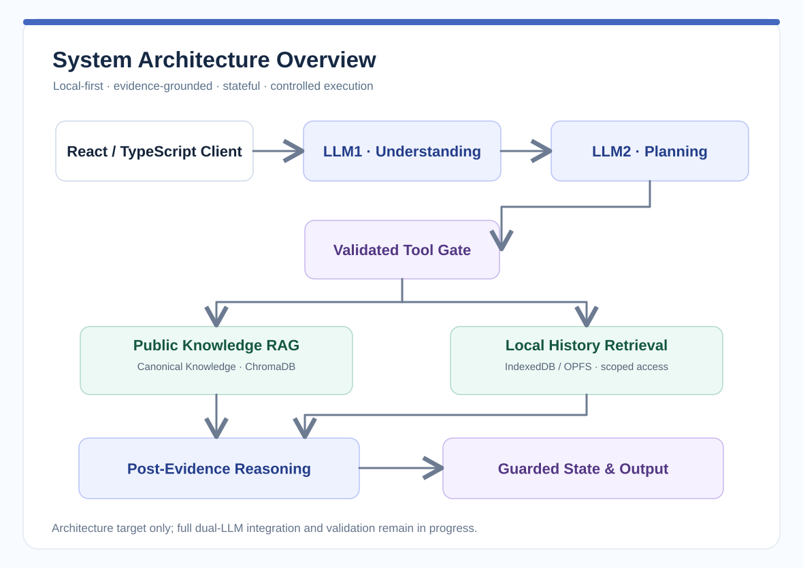

# Rabbit Health Agent

**A local-first, stateful AI assistant for rabbit care — designed around evidence-grounded RAG, tool orchestration, structured conversation state and controlled record operations.**

**Role:** Independent AI application / full-stack developer; architecture, AI-assisted implementation, integration, debugging and testing.  
**Stack:** Python · FastAPI · React · TypeScript · LLM APIs · ChromaDB · IndexedDB · OPFS · Docker · GitHub Actions  
**Status:** Active engineering R&D. The full next-generation agent workflow is **not yet production-qualified**.

**English** | [简体中文](README.zh-CN.md)

## Why this is more than a RAG chatbot

A typical RAG demo retrieves a few text chunks and asks an LLM to answer. This project tackles a harder problem: a conversation may mix care questions, observations about one or more rabbits, requests to inspect earlier records, corrections to prior statements and possible record-saving actions.

The system is designed to keep **language understanding**, **evidence retrieval**, **tool execution**, **persistent state** and **user-authorized changes** separate. It aims to make those boundaries inspectable and testable instead of treating an LLM response as an executable command.

It is a care-information and record-support project, **not an automated veterinary diagnostic service**.

## System architecture

The diagram describes the **architectural responsibilities and intended integrated flow**, not a claim that every arrow is already enabled in the released application.

**Important boundary:** A two-stage Pre-RAG approach is the selected development direction and has isolated prototypes. The complete multi-capability task planner and new end-to-end wiring are still being integrated and evaluated. The existing application path must not be confused with this target architecture.

[Read the system architecture and design decisions](docs/architecture.md).

## Engineering work

### 1. Evidence-first knowledge engineering

Designed a build-time knowledge pipeline that separates verified sources, reusable canonical knowledge, retrieval units and vector indexing:

**Source Research → Canonical Knowledge → Retrieval Units → Embeddings → ChromaDB**

This separation preserves source provenance and lets retrieval representations change without treating a research document or arbitrary text chunk as an authoritative runtime instruction. The project includes query refinement and evidence-relevance/sufficiency evaluation paths, with isolated technical benchmarks; passing a scripted benchmark is not presented as proof of real-world answer quality.

[Explore the RAG architecture](docs/rag-design.md).

### 2. Stateful conversations and bounded fact corrections

Implemented structured conversation-state foundations for observations, referents, events, outstanding information needs and earlier responses. More recent Core components support explicit **ADD / REVISE / RETIRE** fact-operation compilation and preview with source, identity, version and authorization checks.

A correction must not silently overwrite an unrelated observation or make an older medical explanation valid again. Where a successor is unambiguous, existing references can be maintained under narrow conditions; otherwise the change is deferred or requires review.

### 3. LLM decisions versus deterministic safety controls

Separated a model's interpretation of meaning from the host application's responsibility to validate **real source references, record identity, dates, permissions, state revisions and tool scope**. A quotation's exact provenance is not the same as proving that the model's paraphrase is semantically correct.

This distinction emerged from evaluating concrete failure cases where strict textual matching rejected reasonable paraphrases, while structurally valid outputs could still omit part of a user's request. The dual-LLM understanding/planning design is being refined around these findings; semantic reliability is **not** yet claimed as solved.

### 4. Local-first data and controlled persistence

Built browser-side health-record and private-document storage foundations using **IndexedDB and OPFS**, with explicit record lifecycles, scoped history access, backup/restore checks and user-confirmation boundaries. The architecture uses signed state/continuation and guarded record-commit coordination, rather than giving LLM output direct database write authority.

User-private data remains device-local by default; external LLM or embedding services may receive necessary content when the user explicitly enables those operations.

### 5. Engineering validation, not demo-only prompting

The private codebase uses **Pytest, Ruff, Pyright, Vitest, TypeScript checks, browser tests, Docker-based smoke checks and GitHub Actions**. Evaluation distinguishes schema validity, provenance binding, permitted execution and **human-reviewed semantic correctness**. Real provider probes have also been used to diagnose gaps; they are not described as complete agent acceptance.

## Current stage

| Foundation / demonstrated engineering | Integration still in progress |
| --- | --- |
| Public-knowledge ingestion, canonicalization contracts and RAG evaluation infrastructure | Production qualification of the new complete agent flow |
| Browser-local records, structured state, bounded fact-operation and permission foundations | Full dual-LLM multi-capability planning and cross-stage wiring |
| Automated tests, CI, controlled browser and model evaluations | Robust real-model multi-turn, safety and end-to-end acceptance |

**No polished interactive demo is currently published.** This is a deliberately scoped technical portfolio for a substantial private, actively developed application, not a claim that the final AI assistant is already finished.

[High-level project status](docs/development-status.md) · [Evaluation methodology](examples/evaluation-template.md)

## Repository and sharing scope

This public repository presents **architecture, engineering decisions, validation approach and development boundaries**. The full source code, private knowledge assets, real health data, API credentials, model configurations and production prompts are not published.

The showcase is updated for significant architecture or product milestones, **not for every implementation PR**. Descriptions distinguish implemented foundations from an architecture still undergoing integration and real-model evaluation.
