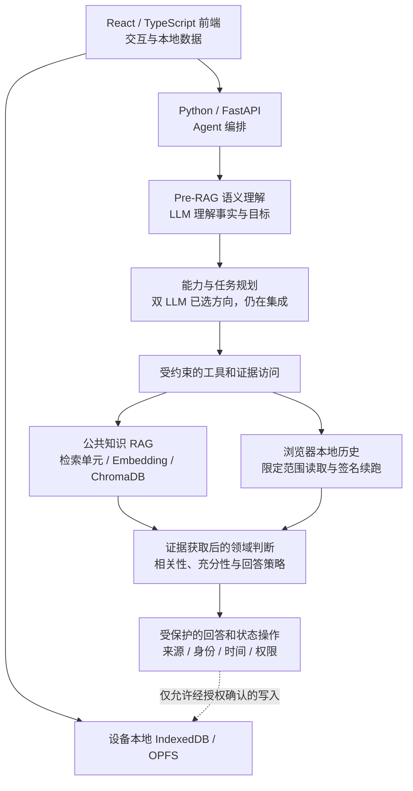

# Rabbit Health Agent｜小兔健康 AI 助手

**一个以本地数据为基础的有状态 AI Agent：围绕可信 RAG 检索、工具编排、结构化对话状态和受控健康记录操作设计。**

**项目角色：** 独立 AI 应用 / 全栈开发，负责架构设计、AI 辅助实现、集成、调试与测试。  
**技术栈：** Python · FastAPI · React · TypeScript · LLM API · ChromaDB · IndexedDB · OPFS · Docker · GitHub Actions  
**项目状态：** 持续研发中；下一代完整 Agent 工作流**尚未完成生产级验收**。

[English](README.md) | **简体中文**

## 为什么它不只是 RAG 聊天机器人

普通 RAG Demo 往往只是检索文本片段，再把上下文交给大模型回答。这个项目尝试处理更复杂的场景：用户可能在同一轮对话中提出护理问题、描述一只或多只兔子的观察事实、查询历史记录、纠正先前说法，或者要求保存记录，同时又对某些操作设置限制。

系统把**语言语义理解、证据检索、工具执行、长期状态和用户授权的数据变更**分开设计。模型可以理解自然语言，但模型输出不能直接等于数据库写入权限或任意工具调用指令。各层边界需要能被检查、复现和测试。

项目定位是护理知识与记录辅助，**不是自动兽医诊断服务**。

## 系统架构

下图表示**目标集成架构中的职责及数据流**，不表示每条链路都已经在正式运行环境中启用。

**架构与现状的区别：** 双 LLM 的 Pre-RAG 理解与规划是当前选定的工程方向，已有隔离实验和实现基础；通用任务规划、跨模块完整接线及生产验收仍未完成。不能把目标架构图理解为所有功能已经上线。

[阅读系统架构与工程设计](docs/architecture.zh-CN.md)。

## 核心工程工作

### 1. 从证据治理开始的 RAG 知识工程

设计了将来源资料、标准化知识、检索表示与向量索引分离的数据处理链路：

**Source Research → Canonical Knowledge → Retrieval Units → Embeddings → ChromaDB**

这套分层保留证据来源与范围，使检索表示可以独立调整，而不是直接把某篇资料或随机切出的 chunk 当成运行时权威依据。项目包含查询修正、证据相关性/充分性检查和隔离技术评测；脚本化测试通过不被当成真实问答质量通过。

[查看 RAG 技术设计](docs/rag-design.zh-CN.md)。

### 2. 跨轮对话状态与受限事实更正

实现了结构化对话状态基础，用于管理观察事实、对话对象、事件、未解决的信息需求和历史回答。较新的 Core 组件已经支持明确的 **ADD / REVISE / RETIRE** 事实操作编译与预览，并验证来源、身份、版本和操作权限。

当用户纠正一条事实时，系统不能随意覆盖无关观察、丢掉历史问题，也不能自动认为旧的医学判断依然成立。对于唯一、范围明确的后继引用，可以在严格条件下维护；复杂或存在歧义的变更需要暂缓或进一步审核。

### 3. 分离 LLM 的语义决策与程序的确定性校验

模型负责判断用户真正表达的含义；程序负责验证**来源是否可信、对象身份、时间与日期、权限、状态修订版本及工具范围**。从原文找到一段精确引用，只能证明证据来源，不等于模型对这段话的理解在语义上必然正确。

在真实评估中，项目遇到过严格字面匹配错误拒绝合理改写，以及格式符合规范但遗漏用户部分需求的问题。因此围绕这些问题推进双 LLM 理解/规划分工，而不是简单用关键词规则修补。**语义可靠性仍在持续验证，不能宣称已经彻底解决。**

### 4. 本地优先的数据与受控持久化

基于 **IndexedDB 和 OPFS** 构建兔子档案、健康记录、私人资料等浏览器本地存储基础，包含记录生命周期、限定范围的历史访问、备份/恢复校验以及用户确认边界。

系统通过有签名的状态和受保护的提交协调来约束记录修改，而不是让大模型直接取得数据库写入权限。

私人数据默认保留在设备端；当用户明确启用远程大模型或 Embedding 服务时，处理所必需的数据可能临时发送给外部服务，不能把 local-first 解释成所有调用都完全离线。

### 5. 系统性工程验证，而不仅是 Prompt 演示

私有代码库使用 **Pytest、Ruff、Pyright、Vitest、TypeScript 检查、浏览器测试、Docker 冒烟验证和 GitHub Actions**。评估严格区分 JSON/Schema 正确、来源绑定合法、工具执行被允许与**人工审查后的语义正确**。

项目也进行过真实模型 API 测试，重点是发现并诊断问题，而不是只展示成功输出；这些实验尚不等同于完整 Agent 的验收。

## 当前进度（里程碑级别）

| 已形成的工程基础 | 正在集成和验证的部分 |
| --- | --- |
| 公共知识来源、标准化知识契约、RAG 检索与评估基础 | 下一代完整 Agent 链路的生产级验证 |
| 浏览器本地记录、结构化状态、受限事实操作及权限基础 | 通用双 LLM 任务规划及跨阶段集成 |
| 自动化测试、CI、受控浏览器实验和模型评估工具 | 真实模型多轮对话、安全与端到端验收 |

**目前没有公开的完整交互式 Demo。** 本仓库是对一个实际持续研发中的私有应用进行的技术展示，并不声称最终助手已经开发完成。

[查看项目状态摘要](docs/development-status.zh-CN.md) · [查看评估方法](examples/evaluation-template.zh-CN.md)

## 公开仓库的内容边界

这里展示的是**架构、工程决策、验证思路与开发边界**。完整私有源码、知识资源、真实健康资料、API 密钥、内部模型配置及生产 Prompt 不在此公开。

该作品集只在架构或产品出现重要里程碑时更新，**不跟踪每一个实施 PR**。文档始终区分已经实现的工程基础，以及还需要集成、真实模型评测和验收的架构目标。
