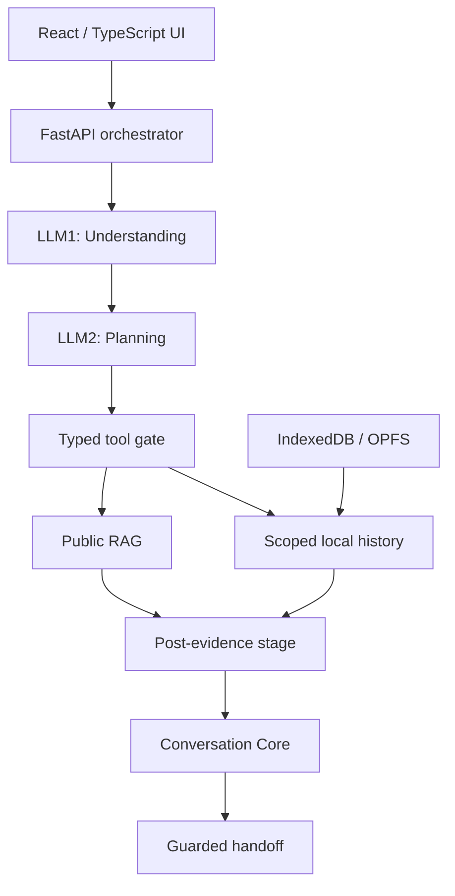

# System Architecture & Engineering Decisions

**English** | [简体中文](architecture.zh-CN.md) · [Back to portfolio](../README.md)

This document describes the system's **technical design and existing engineering foundations**. Some components are proven in isolated test paths; the diagram is an integration target rather than a production deployment diagram.

## 1. Problem decomposition

The application must handle more than one-turn retrieval. A single user message may contain a question, a factual observation, a correction, a request for historical records and restrictions such as “do not save this.” These are separate obligations with different authority and data-access requirements.

The design separates five responsibilities:

| Responsibility | What it owns | What it must not assume |
| --- | --- | --- |
| Semantic understanding | Meaning, referents, observations, user goals, ambiguities | A paraphrase is automatically a verified fact |
| Capability planning | Which tasks and evidence/tools are needed, constraints, dependencies, deferrals | Every recognized goal is safe to execute immediately |
| Evidence acquisition | Public sources and permitted private historical reads | A retrieved passage necessarily answers the question |
| Post-evidence domain reasoning | Relevance, sufficiency, safe follow-up and response decisions | Old reasoning remains current after later fact corrections |
| Deterministic host / client | Identity, source provenance, dates, revision checks, access grants, transactions | Python keyword rules can replace open-ended domain understanding |

## 2. High-level data and execution boundaries



The diagram emphasizes ownership and the **selected direction**. Existing production orchestration and isolated newer contracts are not represented as one already-qualified runtime path.

## 3. Public RAG: governance before vector search

The knowledge pipeline deliberately has distinct build-time and runtime layers:

```text
Source research / verified scope
    → Canonical knowledge sections
    → Stable retrieval representation / units
    → Embedding-space-specific index (ChromaDB)
    → Candidate retrieval
    → Evidence selection, possible refinement, grounding review
```

**Why this matters:** research taxonomy and evolving source notes should not become runtime identity keys. Canonical sections capture reusable evidence with scope and provenance; retrieval units provide an indexing representation. That separation supports traceable selection, corpus maintenance and re-indexing when an embedding provider changes.

The project includes deterministic checks for retrieval traces, selected evidence references, repeated queries, candidate accumulation and benchmark isolation. Actual semantic relevance, medical correctness and sufficiency still require careful evaluation; no single passing fixture implies those outcomes.

See [RAG technical notes](rag-design.md).

## 4. Structured state and corrections across turns

Ordinary chat history is not enough to support a correction such as “I meant yesterday, not today,” while keeping earlier replies and other observations intact. The project has a typed state foundation for referents, events, observations/facts, unresolved information needs and presentation history.

Selected implemented mechanics:

- Source/provenance links preserve the original user evidence alongside later clarifications.
- Fact **ADD / REVISE / RETIRE** compilation and preview reuse one authoritative state and check expected revision and signed context.
- A changed fact does **not** authorize rewriting unrelated facts, deleting a user's old question/answer or automatically releasing an outstanding information need.
- If a correction has one lawful successor under unchanged identity/event/time scope, its reference endpoint can be updated under a narrow grant; uncertain or protected cases are deferred.
- A prior domain rationale is historical context; after a correction, its medical meaning needs fresh evidence-aware assessment rather than implicit trust.

These are implemented bounded foundations. They do **not** establish that every mixed-intent, multi-rabbit or live-model conversation is already supported end to end.

## 5. Two-model semantics and task planning

The selected Pre-RAG engineering direction uses two different model responsibilities:

1. **Understanding:** capture what the user said and meant, including uncertainty and relations, without prematurely forcing every utterance into a tool command.
2. **Planning:** choose available capabilities, source/identity targets, constraints, dependencies and any safe deferral. A structural plan is not automatically an authorized execution.

Deterministic Python validates references and permissions, **not the truth of arbitrary natural-language interpretations**. Exact source quotes can authenticate evidence spans, but must not force a faithful paraphrase to match the original character for character.

Isolated dual-LLM History experiments, controlled real-provider probes and reusable Core fact operations exist. The generalized planner and complete History/Public Evidence/post-evidence/record workflow remain **under integration and real-model qualification**. Real-model experiments have uncovered omissions even when output schemas parsed; this is precisely why structural checks and semantic evaluation are kept separate.

## 6. Local-first records and authority

User profiles, care entries, medical records, attachments and private documents are designed to live locally in browser storage (IndexedDB and OPFS). The backend does not act as the permanent database for the user's private rabbit records by default.

Private-history access uses bounded requests and trusted browser-side execution. Persistent changes require identity checks and explicit authority/confirmation; signed state, revision/commit coordination and guarded transaction boundaries prevent treating LLM text as direct permission to write records. Device-local default does **not** imply that external AI calls transmit no content: optional remote providers process explicitly enabled request data.

## 7. Quality and evaluation discipline

The engineering stack includes Python/FastAPI, Pydantic, React/TypeScript/Vite, IndexedDB/OPFS, ChromaDB and optional local/remote embedding or LLM providers.

Quality practices include:

- Backend Pytest, Ruff and Pyright; frontend type checks, Vitest and browser-based integration tests.
- Containerized HTTP smoke checks and GitHub Actions workflows.
- Isolated benchmark collections and deterministic fixtures that cannot silently modify a live vector index.
- Scoped, auditable real-provider experiments with explicit budgets and no inference that HTTP 200 or valid JSON means semantic correctness.
- Failure classification across provider/schema, provenance, tool eligibility, state authority and actual semantic coverage.

A successful unit/integration test establishes its specified boundary; it is not proof of clinical safety, multi-turn reliability or release readiness.

## 8. Current boundary and public-scope policy

**Already implemented in bounded form:** public knowledge pipeline and technical RAG harnesses, local record foundations, structured conversation state, guarded fact operations, a constrained dual-LLM History experiment and engineering verification workflows.

**Still underway:** general dual-LLM task planning, complete cross-stage integration, actual-provider + browser multi-turn acceptance and release qualification. No finished next-generation Agent demo is claimed.

This showcase intentionally does not reproduce private source code, internal prompts, health records, API keys or raw provider transcripts. Public descriptions focus on transferable architecture and engineering decisions, not private PR-by-PR progress.
