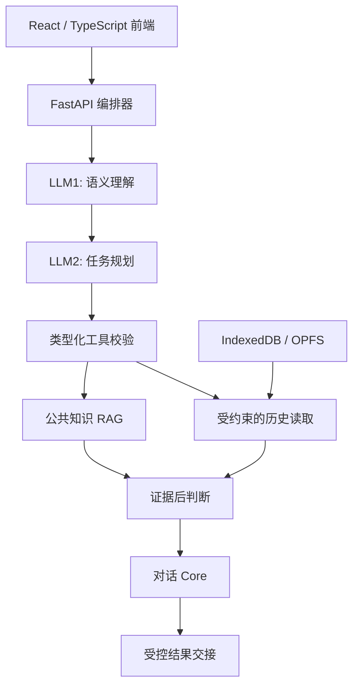

# 系统架构与工程设计

[English](architecture.md) | **简体中文** · [返回作品集](../README.zh-CN.md)

本文说明的是系统的**技术设计与已建立的工程基础**。有些模块已在隔离实验中验证，架构图表示预期集成路径，而不是全部已部署的生产运行链路。

## 1. 问题拆解：不仅是问答

用户在同一条消息中可能包含问题、观察事实、对之前事实的修正、历史记录查询，以及“不要保存”等明确限制。这些意图涉及不同权限、数据依赖和判断责任，不适合全部用一个简单的问答流程处理。

因此系统区分以下职责：

| 层级 | 主要职责 | 不能直接假定 |
| --- | --- | --- |
| 语义理解 | 识别用户表达的事实、对象、事件、目标与歧义 | 合理转述就意味着来源已被验证 |
| 能力/任务规划 | 选择能力和工具，考虑条件、依赖、限制及暂缓操作 | 被识别出的目标都可以立即执行 |
| 证据获取 | 获取公共资料与授权范围内的私人历史记录 | 检索到的内容必然足够回答 |
| 证据后领域判断 | 判断相关性、充分性、追问与回答策略 | 旧理由在新事实出现后仍是当前结论 |
| 确定性程序与客户端 | 处理来源、身份、时间、权限、版本和事务 | 用 Python 关键词就能替代自然语言理解 |

## 2. 整体数据和执行边界



此图重点表达各个模块的**责任和目标接口**。现有工作路径与较新的隔离实验合同尚不能等同于一个已经完成验收的正式链路。

## 3. 可信 RAG：在向量检索之前先管理知识

知识从原始材料进入检索系统时，分成构建期和运行期两个层次：

```text
Source Research / 已核验来源范围
    → Canonical Knowledge / 可复用的知识段落
    → Retrieval Units / 检索表示单元
    → Embedding 与 Chroma 索引
    → 候选召回
    → 证据选择、必要的补充检索与 Grounding 检查
```

**设计意义：** 研究资料的主题分类和 Batch 编号会变化，不适合作为长期运行时身份标识。Canonical Knowledge 保留可复用的语义内容、来源范围及证据边界；Retrieval Unit 则是面向具体检索方式的表示。二者分离有助于来源追踪、知识维护和 Embedding 迁移。

项目使用确定性检查核实检索轨迹、被选证据、重复查询、候选累积和测试索引隔离。但资料是否在语义上真正充分、医学上是否可靠，仍需要实际评估；固定测试样例通过不能证明所有问答正确。

进一步说明见 [RAG 专项技术文档](rag-design.zh-CN.md)。

## 4. 跨轮对话状态与事实更正

仅仅保存聊天记录，不足以支持用户在后续说“我说的是昨天，不是今天”，同时确保其他观察事实、先前的问题及回答不被误删除。

项目建立了类型化的对话基础，区分对话主体、事件、观察事实、尚待补充的信息需求以及实际展示过的问答。

已有的受限实现机制包括：

- 为事实和后续澄清保留原始用户来源与证明关联。
- 事实 **ADD / REVISE / RETIRE** 的编译与预览复用唯一的权威状态，检查版本和签名上下文。
- 更正一条事实，不自动允许改写无关事实、删除历史问答或解除未完成的信息需求。
- 只有在目标、事件、时间范围和来源等条件符合且后继唯一时，才能通过受限权限维护引用；否则暂缓。
- 旧的领域判断理由是历史信息，事实变化后必须重新由证据后判断阶段审核，而不是直接沿用。

这些是**已经实现的有界能力基础**，不意味着任意混合意图、多兔子场景和真实模型多轮对话都已端到端完成。

## 5. 双 LLM 语义理解与任务规划

当前选定的 Pre-RAG 方向，把模型工作拆成不同的职责：

1. **LLM1 — Understanding：** 理解用户表达的语义，保留事实、目标、关系、歧义与不确定性，避免过早强行映射成工具命令。
2. **LLM2 — Planning：** 在已有语义基础上选择支持的能力、工具、对象、约束、依赖和必要的暂缓动作；得到计划不代表天然获得执行权限。

确定性 Python 负责校验来源和权限，**并不负责独立判断全部自然语言语义是否正确**。原文中的精确片段可以用于证明来源真实性，却不应要求合理的语义转述在字面上完全一致。

当前已有受限的双 LLM History 实验、真实供应商受控评估和可复用的 Core 事实操作。通用 TaskPlan 以及完整的 History、Public Evidence、领域判断与记录持久化流程仍在**集成及真实模型验收**。实际实验已经表明 Schema 合法也可能出现意图遗漏，因此不能用结构化成功代替语义成功。

## 6. Local-first 的数据和权限

兔子档案、日常记录、就诊资料、附件和私人参考文档主要保存在浏览器 IndexedDB、OPFS。本地优先意味着后端默认不承担这些用户私人健康资料的长期数据库职责。

历史读取遵守有限范围和可信浏览器侧执行；长期记录更改需要身份校验、用户确认和受控提交。系统依靠签名状态、修订版本和事务边界防止把模型生成文本直接作为写库许可。

**本地优先不等于绝对离线：** 用户启用远程 LLM 或 Embedding 供应商后，必要请求内容仍可能发送给对应外部服务。

## 7. 工程质量和评估方法

工程技术包含 Python/FastAPI、Pydantic、React/TypeScript/Vite、IndexedDB/OPFS、ChromaDB，以及可配置的本地或远程模型/Embedding 能力。

- 后端 Pytest、Ruff、Pyright；前端类型检查、Vitest、浏览器集成测试。
- Docker 容器与 HTTP 冒烟验证、GitHub Actions 自动化检查。
- 相互隔离的评测索引与确定性样例，不将评测误写入正式检索集合。
- 明确预算、可追溯的真实模型测试；不把 HTTP 200 或 JSON 合法等同于语义正确。
- 将模型/Schema、来源引用、工具资格、状态权限与真正的语义覆盖分开归因。

单元或集成测试能证明规定的边界，不代表临床安全、长期多轮可靠性或正式发布资格已经满足。

## 8. 当前技术边界与公开范围

**已有的工程基础：** 公共知识链路和 RAG 评估工具、本地记录、结构化对话状态、受保护事实操作、受限双 LLM History 实验及工程验证流程。

**仍在推进：** 通用双 LLM 任务规划、完整跨阶段集成、真实 Provider + 浏览器的多轮验收与最终发布资格。本仓库不宣称已存在完整可用的下一代 Agent Demo。

本公开作品集不复制私有源码、生产 Prompt、真实用户健康记录、API 密钥或原始模型调用记录，重点展示可迁移的架构能力与实际工程判断，而非追踪每一天的 PR。
